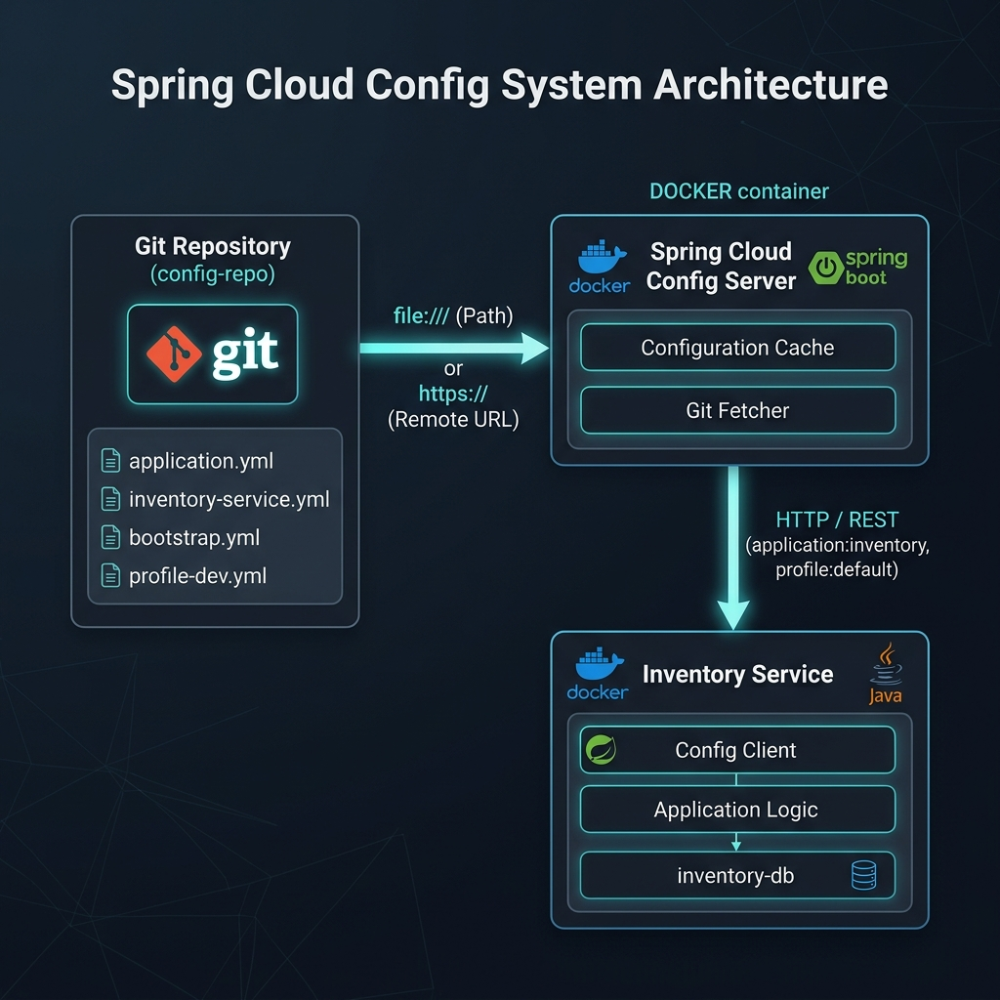
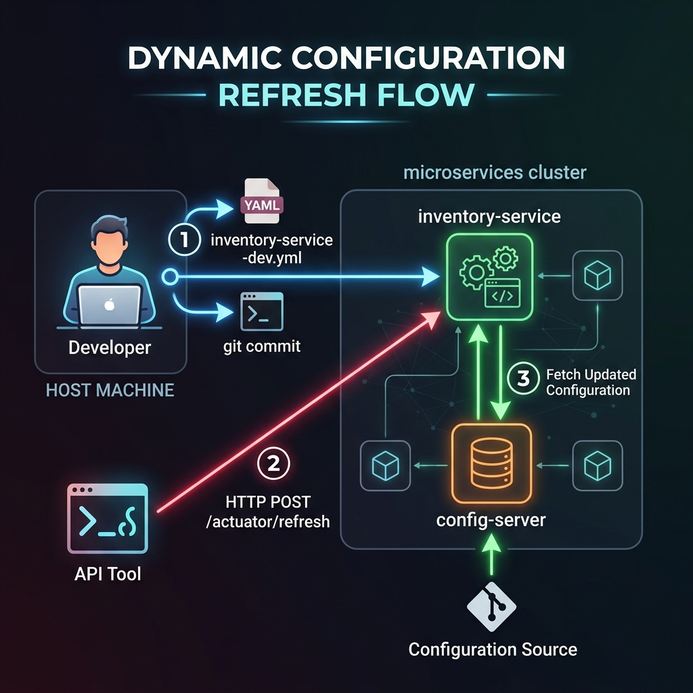

# Centralized Configuration Service with Spring Cloud Config

This repository implements a robust, centralized, Git-backed configuration system for microservices using Spring Cloud Config and Spring Boot. It features an externalized environment-aware config repository, dynamic run-time configuration refreshing, and automated Docker multi-stage orchestration with healthy dependency checking.

---

## 🎥 Project Demo

[](https://youtu.be/Y8ZW6Wagosk)

---

## Core Architectural Concepts

### Decentralized vs. Centralized Configuration

In a decentralized or traditional configuration pattern, each microservice carries its own environment configurations (like database credentials, feature flags, or service limits) inside its local application package (e.g., `application.properties` or `application.yml`).

This traditional approach has critical flaws in distributed production environments:
1. **Redundant Configurations**: The same setting (like database URLs or email server configurations) is duplicated across multiple services, leading to inconsistencies.
2. **Configuration Drift**: Over time, settings on dev, staging, and production environments drift apart, causing bugs that only show up under specific environments.
3. **No Auditing or History**: Changes are made directly on servers or pushed through code, making it difficult to audit who changed a setting or when it was changed.
4. **Service Downtime**: Applying any configuration change requires rebuilding, packaging, and restarting the entire microservice, dropping active traffic.

**Centralized configuration** resolves these issues by moving all configuration files to a centralized provider (Spring Cloud Config Server) backed by a version-controlled repository (Git). Client microservices query this central server at startup to retrieve their environment-specific settings.

---

## System Architecture



The system consists of the following components:

1. **Config Repository (`config-repo/`)**: A local Git repository containing configuration files (`inventory-service-dev.yml`, `inventory-service-prod.yml`) for different environments. This provides version control, rollback capabilities, and commit-based audits.
2. **Config Server (`config-server/`)**: A Spring Boot microservice built with `spring-cloud-config-server`. It exposes properties from the Git repository via standard HTTP REST APIs.
3. **Inventory Service (`inventory-service/`)**: A client microservice running Spring Boot. At boot, it resolves the config server's location via its bootstrap context, downloads target configurations, maps them using `@ConfigurationProperties`, and features hot-swappable `@RefreshScope` beans.
4. **Docker Compose Orchestration**: Links the services together, ensuring that `inventory-service` only starts after the `config-server` passes its Actuator health check.

---

## Conceptual Deep Dive

### 1. Real-World E-Commerce Use Case
To understand the business value of this architecture, consider an e-commerce platform during a high-traffic sales event (e.g., Black Friday):
* **The Scenario**: Under normal conditions, the `inventory-service` has `maxStock` set to `100` and `replenishThreshold` set to `10` to manage warehousing costs.
* **The Challenge**: During a flash sale, order volume spikes. If stock thresholds are too low, warehouses cannot keep up with order processing, causing delays. If you attempt to update settings by restarting the services, you block checkout requests, losing thousands of dollars per second.
* **The Solution**: By updating the configuration in the centralized Git repository to `maxStock: 250` and committing it, you can push the update dynamically via `/actuator/refresh`. The settings update instantly with **zero downtime** and **no dropped transactions**.

### 2. Under the Hood: The Bootstrap Context
Spring Boot uses two distinct contexts during startup when a Config Client is active:
1. **Bootstrap Context**: Initialized by `spring-cloud-starter-bootstrap`. It loads `bootstrap.yml` first and queries the Config Server before any other bean is loaded. This allows it to fetch database passwords and connection pools *before* initializing the primary datasource.
2. **Application Context**: The main context that boots up *after* configurations are loaded. It runs on the properties ingested from the Config Server during the bootstrap phase.

### 3. How `@RefreshScope` Works Internally
When you annotate a Spring bean with `@RefreshScope`:
* Spring does not create a standard singleton bean. Instead, it wraps the bean in a lazy-initiating **Proxy**.
* When you call a method on the bean, the proxy intercepts the call and resolves the actual bean from a cache.
* When the `/actuator/refresh` endpoint is hit, Spring publishes a `RefreshScopeRefreshedEvent`.
* The `RefreshScope` lifecycle listener catches this event and clears the bean cache.
* On the very next request, the proxy finds the cache empty, instantiates a new bean, and binds the newly fetched configuration properties from the environment dynamically.

---

## Centralized Configuration Tools Comparison

| Feature | Spring Cloud Config | Kubernetes ConfigMaps | HashiCorp Vault | Consul |
| :--- | :--- | :--- | :--- | :--- |
| **Primary Focus** | Java/Spring Ecosystem | Container Orchestration | Secrets & Encryption | Service Discovery & Config |
| **Backend Store** | Git, SVN, Vault, JDBC | etcd (Kubernetes store) | Encrypted storage engines | Key-Value Store / Raft |
| **Audit Trail** | Yes (via Git history) | No (requires external logs) | Yes (detailed access logs) | Yes (key-value history) |
| **Dynamic Refresh** | Yes (Actuator / Spring Cloud Bus) | Yes (requires volume reload) | Yes (requires client polling) | Yes (Consul Template / Client) |
| **Security/Secrets** | Moderate (supports encryption) | Low (base64 encoded only) | Extremely High (HSM, leasing) | Moderate (supports ACLs) |

---

## Getting Started

### 1. Set Environment Variables
Configure your target environment by creating a `.env` file in the project root based on the provided `.env.example`:

```bash
cp .env.example .env
```

The default configurations target the `dev` profile.

### 2. Build & Start the System
Launch the entire suite using a single command:

```bash
docker-compose up -d --build
```

---

## Dynamic Configuration Updates Workflow



---

## Production Security & Resilience Recommendations

For a production deployment, the following changes should be applied:
1. **Symmetric/Asymmetric Encryption**: Use Spring Cloud Config's encryption features (by configuring `ENCRYPT_KEY` environment variable) to encrypt sensitive data like database passwords inside the Git repository (e.g., `password: '{cipher}FK982H...'`).
2. **Spring Retry & Fallbacks**: Configure `spring.cloud.config.fail-fast=true` along with the `spring-retry` dependency on the client. This implements exponential backoff to handle temporary config-server disconnects during boot.
3. **Access Control**: Secure the Config Server endpoints using Spring Security (Basic Auth or OAuth2 JWT validation) to prevent unauthorized services from reading configurations.
4. **HashiCorp Vault Integration**: Integrate Vault as a backend for Spring Cloud Config to store secrets, while keeping application properties in Git.

---

## Core API Reference & Verification

### 1. Config Server - Direct Configuration Check
Verify that the Config Server properly loads and translates the Git repository's YAML to a structured API response:

**GET** `http://localhost:8888/inventory-service/dev`

**Sample Response**:
```json
{
  "name": "inventory-service",
  "profiles": ["dev"],
  "propertySources": [
    {
      "name": "file:///etc/config-repo/inventory-service-dev.yml",
      "source": {
        "inventory.maxStock": 100,
        "inventory.replenishThreshold": 10,
        "server.port": 8081
      }
    }
  ]
}
```
* **Explanation**: The response contains the application's configuration metadata. The `propertySources` array lists the active files, and the `source` block lists the exact key-value pairs parsed from `inventory-service-dev.yml` to be served to the client.

### 2. Client Config - Read Ingested Properties
Query the running client microservice to ensure it mapped the configuration values:

**GET** `http://localhost:8081/api/inventory/config`

**Expected JSON**:
```json
{
  "profile": "dev",
  "maxStock": 100,
  "replenishThreshold": 10
}
```
* **Explanation**: This is the mapped output of the `@ConfigurationProperties` bean, verifying that `inventory-service` correctly ingested properties from the Config Server and bound them to Java fields.

### 3. Custom Health Indicator Check
Validate connection status with the configuration provider:

**GET** `http://localhost:8081/api/inventory/health`

**Expected Response**:
```json
{
    "status": "UP",
    "configServer": "connected"
}
```
* **Explanation**: This calls a custom `HealthIndicator` bean (`ConfigServerHealthIndicator`). If the application has loaded configurations (verified by searching for the `inventory.maxStock` property in the Spring environment), it returns an `UP` status. This integrates with `/actuator/health` to report consolidated microservice health.
